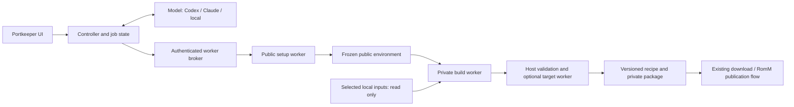

# Autonomous port setup: proposal for review

Status: broader design proposal originally reviewed against commit `50211b3`.
An initial offline script-worker implementation is now included; see
[Automatic port setup](AUTOMATION.md) for its actual contracts, deployment and limits.
The architecture, pseudocode and acceptance matrix below describe the full target;
they do not imply that every backend or acceptance case has been implemented.

## What Portkeeper is supposed to be

Portkeeper is a self-hosted application for setting up, preserving, updating and
distributing game ports within a user's own library. The typical deployment is a
Docker container on Unraid, alongside RomM and an existing local ROM/game-file
collection. RomM organizes and serves the library; Portkeeper handles the port's
preparation, build and package lifecycle. Packages can also be downloaded directly
or copied to a local library folder without RomM.

The user supplies a port repository, desired platforms, and access to their existing
game files. Those inputs can be ROMs, disc images, console packages with separate
updates, archives, extracted game directories or PC data files. The desired result
is a versioned package containing the runtime, required prepared data when feasible,
launch instructions, dependency/setup information and an honest verification record.
Portable layout and settings are goals to investigate and verify, not properties to
assume for every upstream runtime.

The app should determine what a project actually produces, detect its supported
platforms, locate suitable local inputs, work out preparation/build steps and do the
work. A curated catalog provides convenient starting points, but must not determine
which games can be automated. The intended scope includes unfamiliar ports the
maintainer has never configured. No per-game maintainer adapter should be required
before an autonomous attempt can begin.

### The complete user workflow

1. Add a game from the catalog or provide an upstream repository. Detect available
   runtime platforms and let the user choose the desired ones.
2. Find the required owned files in the configured local library; select an unambiguous
   verified match automatically, or ask for the one unresolved input choice.
3. Set up automatically: prepare data, obtain or build the runtime, configure the
   package and validate the result. Show progress and a useful next action.
4. Download the package or send it to RomM according to the user's chosen policy.
   Explain how to launch it, any first-run requirements and what was actually tested.
5. Monitor upstream releases. Reuse a working recipe, repair it when needed and retain
   the previous working package while a replacement is being prepared.
6. Keep useful older versions, record startup/gameplay results and allow rollback.
   Preserve source, dependency and package identities so the history remains auditable.

### Simple default experience, open advanced controls

The product should be understandable to someone who does not know build systems.
One consistent status and next action should explain what is happening. Users should
not have to understand JSON schemas, compilers or extraction utilities to add a port.

The intended game-page organization is:

- **Play:** platform downloads, launch/setup instructions, covers and test results.
- **Updates:** upstream checks, automation choices, release history and rebuilds.
- **Advanced:** complete packaging JSON, generated scripts, dependency information,
  prompts, model replies, logs, preservation material and retention controls.

Everything that determines a build should remain inspectable, copyable, exportable
and editable. Advanced users should be able to tinker with the manifest and scripts,
compare revisions and test their changes. These controls should complement the
automatic flow rather than become mandatory steps in it. Metadata, covers,
notifications, storage settings and model connections are part of the surrounding
library-management experience.

Models can be local (such as Ollama), connected through compatible/API services, or
accessed through Codex, Claude Code and Gemini account integrations. Users should
be able to choose a provider without changing the automation capabilities. Budgets
and progress must be visible. Existing successful recipes should replay without an
LLM call; model usage is primarily for discovery, new procedures and repairs.

### Preservation and ownership

Upstream source/releases must be captured before execution, and package history must
identify the source, tools, inputs and procedure used. Original local inputs should
remain unchanged. Generated packages containing owned data belong in the user's
private storage/library, not a public recipe export. Source, scripts and manifests
are distinct from the game payload. The detailed worker/privacy boundaries appear
later in this proposal.

The existing app already supplies parts of this library, preservation and packaging
workflow. The general autonomous worker described below is proposed work. Reviewers
should evaluate it as an extension of the complete product, not as a standalone
chatbot, a single-game installer or a catalog of permanently fixed extraction tools.

## Autonomous setup objective

Given a repository, requested platforms and locally available owned game files,
Portkeeper should attempt to produce a usable package without someone writing a
game-specific adapter first. It should discover requirements, obtain dependencies,
write and execute preparation/build scripts, inspect failures, repair its approach,
and save the successful procedure for subsequent builds.

It cannot guarantee every upstream project will work. The stopping conditions should
be concrete: required input or key missing, incompatible upstream code, unavailable
target environment, ambiguous input choice, failed verification, or exhausted budget.
“No handwritten adapter exists” should not be a stopping condition when a general
worker is available.

Successful packaging, observed startup and tested gameplay are separate claims.

## What the current code does

| Existing component | Reuse | Limitation to remove |
| --- | --- | --- |
| `portkeeper/investigation.py` | Bounded evidence retrieval, citations, input metadata, model request budgets | `capabilities()` declares arbitrary source compilation unavailable; plans are restricted to existing operations/tools. |
| `portkeeper/drafting.py` | Release/source/packaged README inspection and archive manifests | Its main task is generating a fixed-vocabulary packaging definition. |
| `portkeeper/assistant.py` | Ollama, compatible API, Claude API and subscription-provider transport | Add a distinct worker-agent task contract, rather than repurposing definition prompts. |
| `portkeeper/subscription_agents.py` | Official sign-in, isolated account sessions, restricted text transport | Keep credentials and native CLI processes outside build workers. |
| `portkeeper/runner.py`, `modeltools.py` | Existing recipes, input identities, disposable trials, package checks | Existing operations cannot discover/install arbitrary tools, compile new projects, or prepare arbitrary game directories. |
| `portkeeper/engine.py` | Queue, persisted jobs, captures, immutable artifacts, publication | Add an adaptive job state machine and a reusable script-recipe runner. |

Current `compose.yaml` mounts no Docker socket. Deploying a real worker is therefore
a prerequisite, not something a prompt change can enable.

### Evidence for the transport reuse claims

Existing transport code is reusable, but this is not evidence that the proposed worker
protocol or an unfamiliar-port agent loop works today. Distinguish:

- `tests/test_drafting.py`: controlled HTTP replies exercise Ollama and API request/
  response handling; they are not live model-quality evaluations.
- `tests/test_subscription_agents.py`: fake vendor CLIs exercise authentication,
  restrictions and RPC/message handling.
- `tests/test_real_subscription_agents.py`: opt-in checks against the shipped native
  CLIs verify available controls, unauthenticated state and some native protocol
  contracts. They intentionally perform no inference or subscription login.
- `tests/test_investigation.py`: controlled replies exercise evidence requests,
  response normalization, citations and disposable package checks. These do not test
  the unimplemented arbitrary-script worker.
- Operator-reported Codex replies show real inference has been used in the current
  app, not comprehensive live conformance across all providers.

Before enabling a provider for the new loop, run opt-in live conformance cases with
public fixtures: valid action, evidence follow-up, malformed action recovery, command
failure repair, cancellation/quota handling and clean recipe replay. Record actual
provider/model/CLI versions and request counts. A provider is unavailable for that
mode if its checks or authentication fail; do not silently switch billing modes.

## Architecture



The model requests actions; the controller executes them through a broker. The broker
owns worker creation, mounts, network policy and limits. A model cannot supply Docker
privilege flags, host paths, Docker socket mounts or credential mounts.

A companion worker service can use a rootless container backend initially, with a
VM/stronger isolation backend later. The main web app and model sessions must not
receive an unrestricted host Docker socket. A broker with access to a daemon is
itself a privileged control component and needs authentication and narrow APIs.

### Threat model and deployment gate

Assume repository content, dependencies, model output and generated programs can be
malicious. Protect NAS files outside the assigned job, original inputs, controller/
provider credentials, private observations, publication destinations and host resources.
Trust the controller/broker and configured virtualization boundary; test that boundary
instead of treating JSON argument validation as sufficient isolation.

| Threat | Required boundary / evidence |
| --- | --- |
| Writes outside the job or input mutation | Read-only selected-input mounts; job-owned writable storage; deny arbitrary host mounts and namespace/device/socket access; detect changed inputs. |
| Credential or LAN access | Credentials outside workers; authenticated broker; private workers offline; public dependency fetching cannot reach private/loopback/link-local addresses, including redirects and DNS changes. |
| Private data echoed through files/logs | Sticky private classification for the entire private workspace and descendants; no cloud file/log reads or public-cache promotion. |
| Covert private feedback | Choose the explicit privacy policy below; do not claim that filtering filenames/statuses/timing proves non-interference. |
| Runaway processes, disk or inference | Persisted budgets, process-group/container cancellation, hard resource quotas and reservation before each billable/worker action. |
| Forged success or publication | Host checks actual files/processes; model-written test summaries are advisory; publication follows controller policy and cannot accept a model-selected destination. |

Rootless containers reduce host privileges but are not a proof against kernel escape
or an assertion that every Unraid installation supports the required isolation.
Prove user-namespace support, mounts, quotas, network policy and cancellation on the
actual deployment. If unavailable, use a dedicated trusted Linux VM/worker rather than
silently enabling privileged containers or weakening the policy.

Before running arbitrary agent code, demonstrate these boundaries with adversarial
fixtures. The acceptable baseline is bounded execution and no intentional host access
or raw private-file/log upload. It does not promise protection against every kernel
vulnerability or formal elimination of information leakage in the metadata-feedback
mode. Operators requiring those stronger guarantees need the stricter backend/policy.

## The adaptive job

1. **Capture:** pin source commit, release assets and checksums. Read full useful
   documentation on demand, including files inside release archives.
2. **Resolve inputs:** the controller searches the configured local input inventory.
   Models see opaque candidate IDs, formats, sizes and recognized identities. Bind
   unique verified matches automatically; request a choice when candidates remain
   ambiguous. Never treat an empty selected-input list as proof that no data is needed.
3. **Public setup:** inspect source, find tools, install dependencies and write scripts
   in a disposable worker containing no owned data or credentials. Public build-tool
   logs can provide detailed compiler feedback. Capture every download and resolved
   dependency so this environment can be replayed.
4. **Freeze environment:** retain a digest-addressed public environment and source/
   script snapshot. Freeze before mounting game files. Do not turn a private workspace
   into a public container image or shared dependency cache.
5. **Private preparation/build:** start a fresh worker from that environment; mount
   only bound inputs read-only under worker aliases. Extract, convert, compile with
   assets if required, and assemble the package in job-owned storage. Network is off.
6. **Validate and repair:** inspect broker-produced results; adjust scripts and try
   again within the remaining budget. Dependency changes require another public
   setup pass and a fresh private worker, not network access for the private worker.
7. **Save and replay:** freeze the successful recipe revision and test report. Repeat
   it from a clean worker without an LLM call before marking it reusable. Use the
   existing separately configured publication flow.

The agent can author new procedures. Existing fixed adapters remain optional shortcuts
and useful examples, not the capability ceiling. General capabilities are reading
public material, fetching dependencies, writing code, executing code in a worker,
processing bound data, and validating outputs.

## Worker and model protocol

Use one versioned action protocol for every provider. Native tool calling can be an
optional transport adapter; ordinary JSON is sufficient for local models. Host
dispatch validates the tool name, arguments, job phase and worker lease before acting.

Illustrative model request:

```json
{
  "action": "tool",
  "tool": "run_script",
  "arguments": {
    "script": "scripts/prepare.py",
    "argv": ["--input", "game_data", "--output", "package/game"],
    "purpose": "Prepare the bound owned-data input using the documented format"
  }
}
```

`game_data` is a host-bound input alias, not a model-selected host directory. Worker
paths are checked against the job workspace. The host chooses the allowed phase,
mounts and limits; putting `private: false` in model JSON cannot override them.

Proposed tools:

| Tool | Scope |
| --- | --- |
| `read_public_file`, `search_public`, `inspect_release` | Preserved source, release documentation and public workspaces. |
| `request_input` | Describe needed data; host discovery returns scoped opaque candidates. |
| `fetch_dependency` | Public origins through the broker, with byte/time limits and captured hashes. Reject local/private-network destinations and credential-bearing URLs. |
| `prepare_environment` | Install/discover tools in a public worker; return dependency/image provenance. |
| `write_script`, `run_script` | New code and commands in the assigned worker. Python, shell, build systems and upstream tools are allowed here. |
| `inspect_result`, `validate_package`, `probe_launch` | Host-generated checks or target-worker observations with explicit scope. |
| `finish`, `blocked` | Request completion or report a concrete blocker; neither bypasses host validation or publishes. |

Keep authentication, worker lifecycle and publication outside model tool access.
Prompts must identify the stage and actual tools clearly. A definition-style answer
such as `{ "explanation": "...", "definition": {} }` is not a worker action.

### Controller sketch

This is interface pseudocode. `broker`, `policy`, `budget`, `validate_request` and
`host_validate` require real implementations; they are the enforcement boundary.

```python
async def automate_port(job, model, broker, policy, budget):
    state = await load_or_create_job_state(job)
    while budget.can_continue():
        # Context includes public evidence, typed observations and opaque inputs.
        context = await make_bounded_agent_context(state, broker, policy)
        budget.reserve_model_request()  # account before inference, including retries
        reply = await model.next_action(context)
        request = validate_request(reply)

        if request.action == "blocked":
            return await save_blocker(state, request.reason)

        if request.action == "finish":
            report = await host_validate(state, broker, policy)
            if not report.required_checks_passed:
                state.add_observation(report.for_model(policy))
                continue
            candidate = await broker.freeze_recipe(state)
            replay = await broker.replay_clean(candidate, job.bound_inputs)
            replay_report = await host_validate_replay(candidate, replay, policy)
            if not replay_report.required_checks_passed:
                state.add_observation(replay_report.for_model(policy))
                continue
            # Applies operator's existing automation/review policy, not model wishes.
            return await save_recipe_and_artifact(candidate, replay, policy)

        operation = policy.authorize(request, state.phase, state.worker_lease)
        budget.reserve_worker_operation(operation)
        result = await broker.execute(operation)
        await save_local_audit(state, operation, result)
        # Broker/host labels observations; model JSON cannot declassify a result.
        state.add_observation(result.for_model(policy))
        await checkpoint(state)
    return await save_blocker(state, "Configured automation budget exhausted")
```

Malformed actions consume the same bounded request allowance and receive corrective
feedback. Add wall-clock, disk, process, memory, CPU and per-command limits alongside
model-call/context limits. Enforce cancellation, restart recovery, single-job input
leases and bounded output while commands are running. Do not leave an unbounded
`communicate()` or unlimited model retry loop behind a nominal timeout.

### Initial budget contract

These are proposed starting defaults, not existing runtime settings or guarantees
that a large port fits them. They should be editable in Advanced, with estimates and
remaining allowance visible before and during a job.

| Limit | Proposed default |
| --- | --- |
| Model requests per new setup/repair job | 20, including malformed replies, reviews and corrections |
| Global automated model requests | 100 per rolling 24 hours across projects |
| Attempts with the same failure and no verified progress | 3; cosmetic script edits do not reset this counter |
| Per-model-request deadline | 180 seconds, with cancellation and unknown-charge reporting |
| Per-command deadline | 10 minutes; explicit compilation profile may use 30 minutes |
| Total worker execution | 120 worker-minutes, including setup, failed attempts and clean replay |
| Whole-job elapsed deadline | 120 minutes, including inference and verification |
| Concurrent autonomous jobs | 1 by default, with a separate per-project execution lease |
| Worker resources | 4 CPUs, 8 GiB RAM, 256 processes; broker-enforced profiles |
| Scratch allocation | Estimate input expansion/copies/output before starting; reserve a capped job quota, initially 50 GiB unless the operator configures a larger allowance |
| Model context / output | 24,000 context characters plus provider-specific token accounting; request at most 4,096 output tokens where the transport supports it |
| Raw command logs | 1 MiB per command, retained locally with classification; model observations have smaller bounded summaries |

Reserve counters atomically before dispatch, persist them across restart/retry and
include automatic reviews, dependency rebuilds and replay costs. Hashing/inspection
also consume elapsed time. Larger inputs or builds must get a sufficient reservation
within operator policy or stop with a resource requirement before filling the NAS.
Do not present character limits as exact token limits.

Currency estimates require current pricing and usage data. A call limit is not a hard
dollar cap, especially for subscription extra usage or transports that cannot expose
an output-token ceiling. Report unknown usage honestly and use provider-side spending
controls where needed. Never enable extra usage or change to paid API billing as an
automatic fallback.

### Restart, leases and idempotence

Give each operation a durable host-issued ID. Journal the intent and budget reservation
before dispatch; the broker must deduplicate that ID and expose status lookup. After
a controller restart, reconcile broker state instead of rerunning an operation whose
acknowledgement was lost. Interrupted inference may have consumed allowance; reserve
it and report the uncertainty rather than assuming the request was free.

Lease the project, worker and bound input snapshot. Originals remain readable and
unchanged; the lease is not a promise that an outside process cannot edit them.
Detect inode/content changes or loss of the mounted input storage, stop the job and
require reconciliation. Independent read-only jobs may share verified inputs, but
cannot share writable workspaces or publish conflicting revisions.

Only a verified broker result can complete an operation. On expired lease or deadline,
cancel the process group/container and reconcile termination. Quarantine incomplete
private outputs; restart non-resumable commands from a clean worker. Persist source,
image, script and input identities with the checkpoint. Publication retains the
existing temporary-file/checksum/atomic-finalization behavior.

## Local data and cloud models

Raw owned game files remain on trusted local workers. Account/API credentials remain
on the controller. Original inputs are read-only, and the controller verifies identity
before/after use so a file changed during copying/building is not silently accepted.
Large files need disk preflight and copy-on-write/private working copies where possible.

Public setup logs can be supplied to any model. After private inputs are attached,
treat the entire workspace, generated files and raw logs as private. Cloud `read_file`
must not read them through a renamed output, a symlink, or a supposedly public cache.
Return host-generated diagnostics and bounded metadata instead: missing declared
output, recognized input identity mismatch, output format/architecture, build status,
and the next required action. Keep raw private logs available to the operator locally.

There is a real tradeoff: arbitrary code can encode private information into observable
outputs, statuses or filenames. Redacting logs is not a formal guarantee that arbitrary
agent-authored code cannot leak data through feedback. Stronger private-debugging policy
requires an explicitly trusted local model for private observations, or restricted
reviewed private processors. Cloud models can still research and author public scripts.
Do not advertise absolute private-data isolation while also allowing unrestricted
private code and unrestricted observations to a cloud model.

Two proposed policies make this tradeoff explicit:

- **Metadata feedback:** cloud models may author scripts and receive only host-created
  bounded diagnostics from private execution. Raw files/logs stay local. This allows
  cloud-assisted repair but accepts residual leakage through observable outcomes.
- **Strict private processing:** no private-derived observations go to a cloud model.
  Adaptive private debugging uses an explicitly trusted local model; alternatively
  execute a reviewed deterministic processor with local host validation. Cloud models
  can still handle public setup. If private adaptation is needed and no eligible local
  model exists, report that requirement instead of falling back to cloud feedback.

Choose and disclose the policy once at configuration; do not invent per-game approval
rituals. An Ollama/provider label alone does not establish offline processing: confirm
the actual endpoint, forwarding/telemetry configuration and network boundary. Routing
models by phase is supported, but requiring a local model for every public task would
unnecessarily remove the user's cloud-provider choice.

Worker defaults: no host namespace access, no privileged mode, no devices unless a
configured test requires them, no host credentials, no daemon socket, dropped
capabilities, restricted mounts and resource limits. Private workers have no network.
Dependency fetching/installing occurs only in public setup and uses normal TLS and
artifact integrity checks. These are execution controls, not per-game approval prompts.

## Reusable recipes and verification

Save an editable bundle containing a versioned manifest, generated scripts, dependency
locks, source/release hashes, public evidence, expected input identities/layouts,
launch instructions, output rules and the observed test report. Keep private inputs
and generated game data out of exported recipe bundles and public caches.

Introduce a separate workspace runner and a new packaging-definition version rather
than silently changing schema-2 `operations` semantics. Preserve existing definitions.
The generated script bundle is what the new runner replays; JSON remains an editable
manifest, not an exhaustive list of all commands a port might need.

Cache keys include source/release identity, frozen environment, scripts, target and
bound-input identities. Changed code, dependencies or inputs invalidate the relevant
proof. New releases reuse the recipe first, run compatibility checks, and invoke the
agent for repair only when needed. Retain prior working packages while repairing.
Immutable inputs and a model-free replay improve consistency; byte-for-byte identical
builds are a separate property to measure rather than assume.

Host verification must not accept a test merely because the model says it passed.
Check declared output paths and hashes, archive structure, executable type/architecture,
real launch target, required data layout, dependency resolution and input preservation.
Prefer upstream tests and known fixtures over model-written tests alone. Use startup
probes where the target environment allows them. Model-written tests and second-model
reviews are supplementary evidence; they can share the same mistake.

A Linux/Unraid worker can assemble Windows binaries and sometimes cross-compile or
probe through Wine. Wine is not native Windows verification. MSVC-only builds and
native Windows launch checks need a paired Windows worker or an explicit concrete
blocker. Rendering/gameplay may require graphics hardware and separate human evidence.
Record `package_checks`, `startup_environment`, and `gameplay` separately.

Worker selection is a validation requirement, not an afterthought. A Linux worker can
complete structure-checked Windows runtime assembly; report native startup as untested.
A task that specifically requires MSVC/native Windows checks must select an available
paired Windows worker or return that concrete environment requirement. Never upgrade
a Wine result into native Windows verification.

### Dependency freeze contract

Record immutable OCI image manifests/layers and retain an export or controlled cache
sufficient to restore them. Capture exact package artifacts, resolved versions,
checksums, source commits/submodules and build flags. Unpinned `apt install`, `pip
install` or network downloads in a replay script do not satisfy the replay contract.
Disable external dependency fetches during replay and test recovery from an empty
working directory with the retained environment/artifacts. Missing cache/image blobs
produce an explicit preservation failure, not a silently changed environment.

## Provider eligibility and project-specific prerequisites

Technical CLI support, successful login and contractual permission for a particular
backend use are separate questions. Do not infer a blanket ban from non-interactive
operation, or blanket permission from a vendor's supported headless mode.

Official repository documentation inspected on 2026-10-13 provides narrower evidence:

- [Codex README](https://github.com/openai/codex/blob/main/README.md) documents ChatGPT
  plan sign-in; its [app-server repository docs](https://github.com/openai/codex/blob/main/codex-rs/app-server/README.md)
  document a programmatic client/server integration surface.
- [Anthropic's Claude Code Action setup](https://github.com/anthropics/claude-code-action/blob/main/docs/setup.md)
  explicitly documents both API authentication and Pro/Max OAuth-token authentication
  for that official automation integration. That is not approval for every third-party
  product or for every Agent SDK authentication arrangement.
- [Gemini CLI headless reference](https://github.com/google-gemini/gemini-cli/blob/main/docs/cli/headless.md)
  explicitly describes a programmatic interface with structured/JSON output.

The official terms/authentication websites were blocked by this cloud environment's
network proxy during this review. Current contractual eligibility for Portkeeper's
specific unattended, self-hosted backend use therefore remains unverified. Record a
provider-specific review of the applicable current terms, account type, deployment
scope and supported authentication path before enabling that new mode. Never extract
consumer OAuth credentials into an unofficial API proxy or circumvent quota controls.

Keep local and eligible API providers available while account integrations are being
reviewed. An eligibility issue with one transport does not require deleting the
multi-provider abstraction or stopping broker engineering. This proposal does not
disable or change the existing account connections.

Project/input conditions also differ: source/dependency licensing, distribution of
generated packages, extractability of a particular dump, and availability of required
keys must be checked for the selected project and intended use. Do not download
missing owned game data/keys or publicly export payloads because a model suggests it.
Owning a file is not a universal conclusion about all permitted uses. Evaluate the
actual project, tool licenses, input requirements and intended distribution separately
rather than applying one legal conclusion to the entire acceptance matrix.

## Product flow

The main action should be **Set up automatically**. With automation enabled, do not
require a person to approve every plan or write every extraction adapter. Ask only for
an unresolved input choice, a missing key/configuration, or a concrete outside action.
Unattended activation follows an operator-selected policy established once; publishing
uses the existing separately selected destination/automation policy.

Keep the normal screen simple: current step, progress, outcome and one next action.
Advanced exposes the complete manifest, scripts, prompts, observations, dependency
locks, source evidence, limits and test scope, with copy/download/edit controls.
Editing a working recipe creates a new revision and tests it before replacing the
working version. Honest outcomes include ready to download, needs an input, blocked
with evidence, or built with target startup untested.

## Implementation order and acceptance tests

0. **Define the boundary:** select the threat/privacy model and verify the deployment
   can enforce it. Record provider-specific eligibility before enabling that transport
   for unattended use; local/API work and broker development can proceed independently.
   Specify and persist the budget/recovery contract before the adaptive loop.
1. **Broker first:** prove scripts actually execute in disposable public/private
   workers. Test cancellation, limits, denied host/socket mounts, no private network,
   read-only originals, and observation classification. Do not start by merely
   changing prompts or setting `source_build.available = true`.
2. **Generic procedure runner:** support owned directories and supported public/private
   archives through generated scripts, plus clean replay and a versioned recipe bundle.
3. **Adaptive model loop:** integrate the existing providers with the same tool protocol,
   bounded feedback, checkpointing and no required game-specific adapter.
4. **Source compilation and target probes:** exercise a Linux source-only project and
   Windows runtime assembly; add remote native workers where required.
5. **UI and update repair:** route “Set up automatically” into this workflow, expose
   advanced controls, and reuse/repair saved recipes on upstream changes.

### Representative acceptance matrix

These are concrete candidate scenarios for evaluating the general architecture, not
claims that every listed release or input variant is already verified. Use pinned
releases, legally available fixtures or operator-provided files, and record the scope
of each result. Several projects have existing Portkeeper definitions; use those as
regression cases and shortcuts, not proof that unfamiliar projects are supported.

| Project / upstream | Local input scenario | What this tests |
| --- | --- | --- |
| OpenLara — `XProger/OpenLara` | Prepared Tomb Raider data folder, then a documented PC disc-image variant | Discover a prebuilt runtime and its packaged instructions; create the expected data layout and, for the disc case, discover suitable extraction tooling. |
| Banjo Recompiled — `BanjoRecomp/BanjoRecomp` | A compatible Banjo-Kazooie N64 ROM | Identify and normalize the required ROM variant, stage it for the runtime and preserve existing simple packaging behavior. |
| 2 Ship 2 Harkinian — `2ship2harkinian/2ship2harkinian` | A compatible Majora's Mask N64 ROM | Generate the runtime's asset archive with headless tooling, capture tool/runtime dependencies and replay the preparation. |
| OpenGOAL — `open-goal/jak-project` | A compatible Jak and Daxter PS2 ISO | Read project-specific extraction instructions, run the appropriate tooling and combine prepared assets with the selected runtime. |
| God of War III PC — `FelipePrado0/gow3_pc` | Matching PS4 base/update PKGs or a prepared game folder | Distinguish title/version/role, handle base-before-update preparation and report missing extraction requirements or keys concretely. |
| Chocolate Doom — `chocolate-doom/chocolate-doom` | Source checkout plus a compatible owned Doom IWAD | Obtain a build environment, compile a Linux runtime from source, configure its data input and run available upstream/startup checks. |

Use at least two unrelated projects in the initial end-to-end milestone: one involving
prebuilt runtime/data preparation and one involving source compilation. Expand to the
other input/preparation categories as the worker matures. The same worker interfaces
and model protocol should handle every row; a new hardcoded game branch is not the
measure of success.

Include a negative classification case such as `n64decomp/sm64`: a compiler helper
must not be labeled a playable PC game, and rebuilding an N64 ROM must be described
as that product rather than native Windows/Linux gameplay.

Also test wrong inputs, broken upstream code, changed releases, daemon restart, disk
exhaustion, hanging commands, misleading model success and private-data echo. Replay
recorded model responses for controller regression tests and run opt-in live provider
checks. Mocked replies test the protocol, not whether a live model solves an unfamiliar
port. Live-model quality and runtime correctness need separate evidence.

## Questions for other LLMs reviewing this design

Review this proposal against the repository, particularly `engine.py`, `assistant.py`,
`subscription_agents.py`, `investigation.py`, `drafting.py`, `runner.py`, `modeltools.py`
and `compose.yaml`. Begin with the product overview: the goal is a simple, open,
self-hosted game-port automation and preservation companion for an existing local
library, with optional RomM delivery and automatic upstream maintenance.

Evaluate whether the worker can genuinely create new procedures, whether the broker
boundary is enforceable on Unraid, and whether private-data feedback claims are honest.
Identify missing requirements for reproducible dependency capture, native Windows
work, objective testing, unattended recipe activation and accessible advanced editing.

Propose the smallest end-to-end implementation that covers multiple unrelated projects
and preparation/build categories in the acceptance matrix without introducing another
game-specific capability ceiling. Distinguish code that already works from planned
interfaces and tests that need real inference. Do not optimize the architecture around
only one example game or reduce the product to a model-to-JSON drafting tool.
